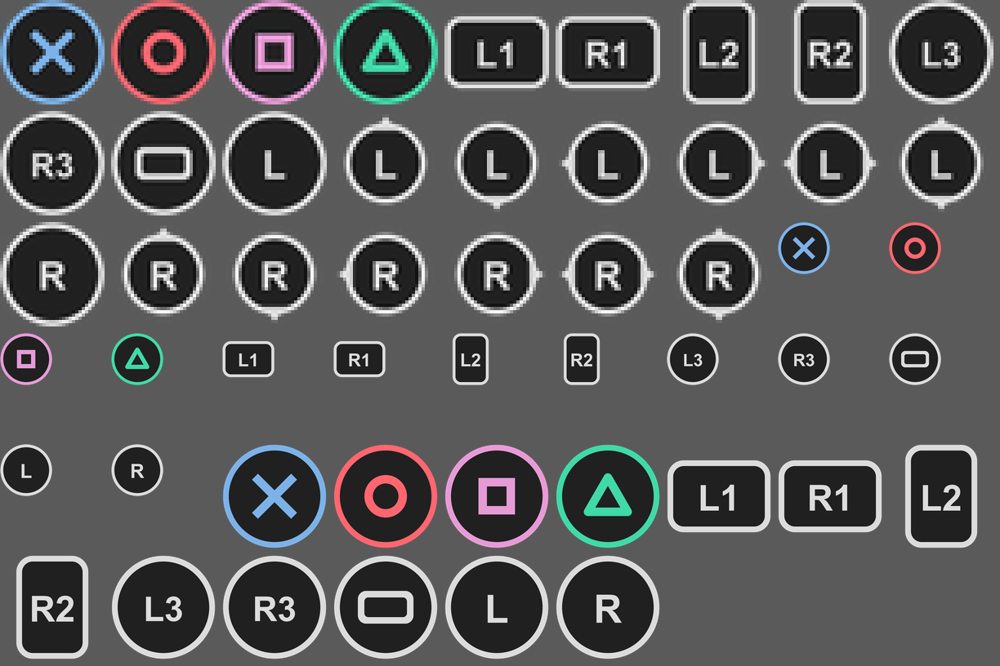
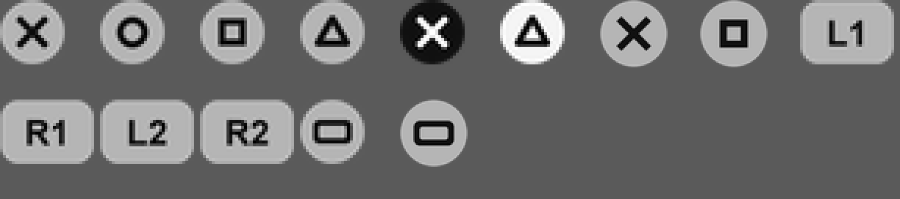
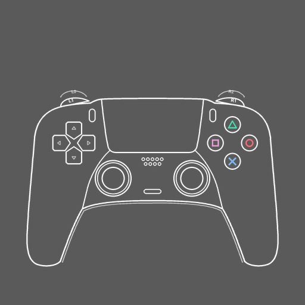

# Forza Horizon 2: botões de PlayStation

Troca os ícones de botão do Xbox pelos de PlayStation no Forza Horizon 2 (versão de Xbox One rodando no emulador Azimuth). Também substitui o diagrama do controle na tela de controles por um DualSense.

Não precisa instalar nem rodar nada: é só copiar os arquivos por cima dos do jogo.

## O que muda

- **Botões de ação:** A → ✕, B → ○, X → □, Y → △, coloridos como no PlayStation.
- **Ombros e gatilhos:** LB/RB/LT/RT → L1/R1/L2/R2.
- **Analógicos:** LS/RS → L/R, e o clique dos analógicos → L3/R3.
- **View → touchpad.**
- **Tela de controles:** o desenho do controle vira um DualSense, e as linhas de legenda apontam para os botões nas posições do DualSense.

D-pad, Menu/Options e o diagrama do volante continuam como no original.

## Instalação

1. **Faça backup** destes 5 arquivos do jogo, para poder voltar atrás:
   - `Mount\media\UI.zip`
   - `Mount\media\zipmanifest.xml`
   - `Mount\media\ui\textures\data_bound\ControllerIcons.zip`
   - `Mount\media\ui\textures\data_bound\Help_Buttons.zip`
   - `Mount\media\ui\textures\data_bound\UI_Symbols.zip`
2. Copie a pasta `Mount` deste repositório para dentro da pasta do jogo (a que tem o `Azimuth.exe`). Quando o Windows perguntar, escolha **substituir os arquivos**.
3. Abra o jogo.

## Desinstalação

Coloque de volta os 5 arquivos do backup.

## Compatibilidade

- Feito para os arquivos de jogo do Forza Horizon 2 que rodam no Azimuth, com o DLC Storm Island.
- **Os 5 arquivos precisam ir juntos.** O `zipmanifest.xml` guarda a posição interna de cada `.zip` do jogo, e os valores dele correspondem aos `.zip` deste repositório.
- **Não combina com outros mods que alterem estes mesmos 5 arquivos.** Um mod que troque outro `.zip` do jogo e também atualize o `zipmanifest.xml` vai entrar em conflito, porque cada um sobrescreve o manifest do outro.

## Problemas conhecidos

- O jogo pode recusar os arquivos ou travar se a sua cópia do jogo for diferente da usada aqui. Nesse caso, restaure o backup.
